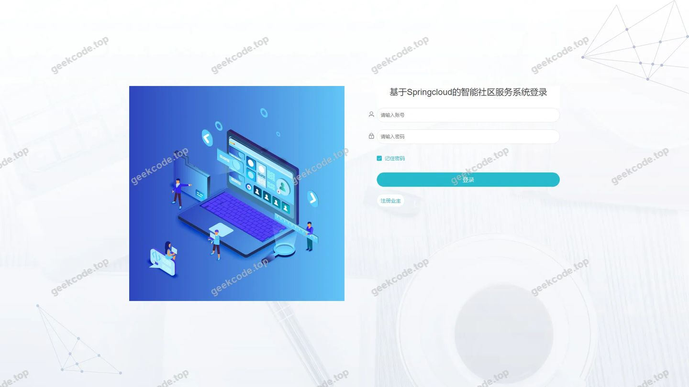
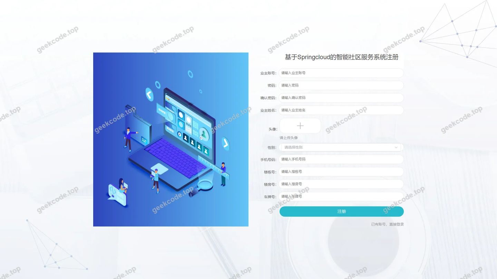
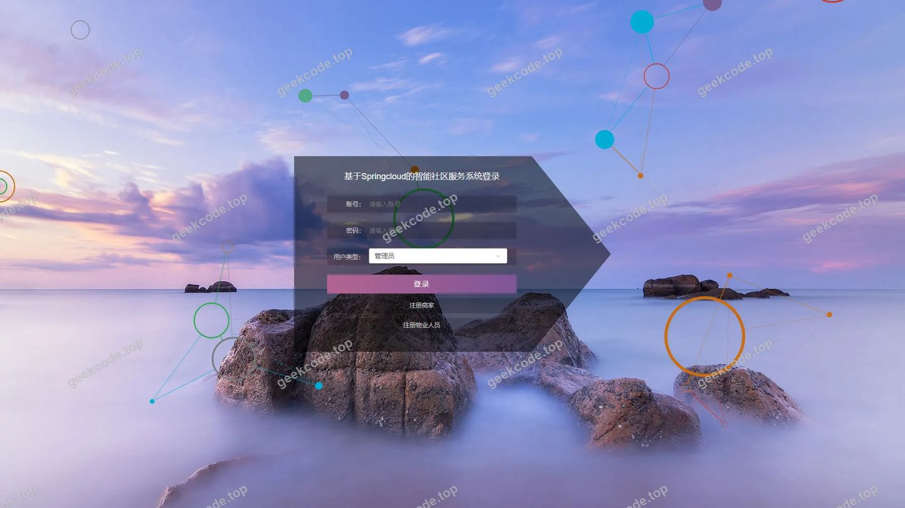
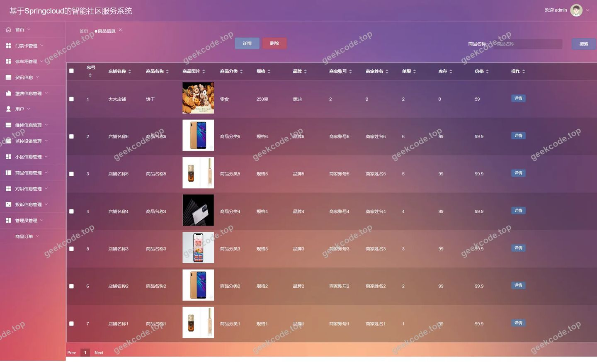
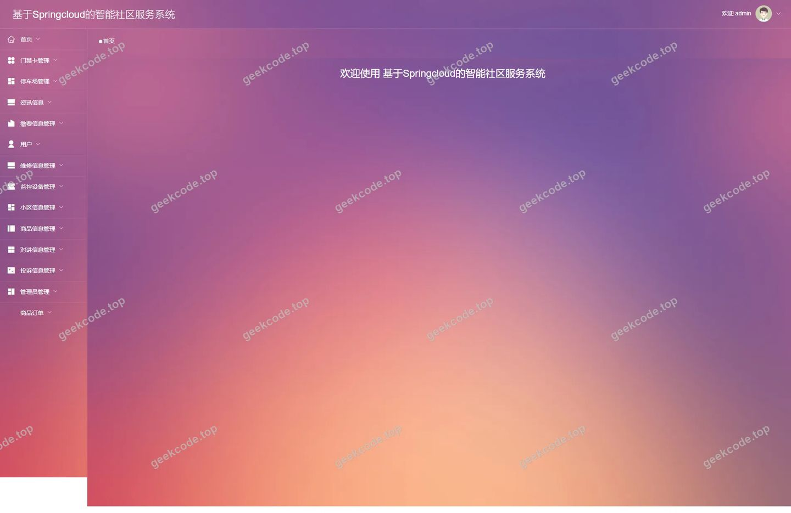
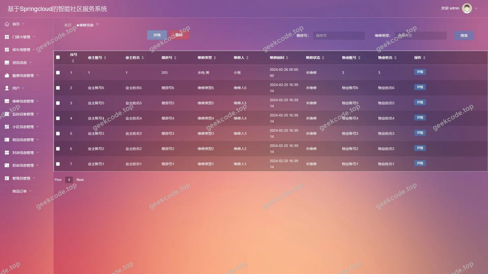
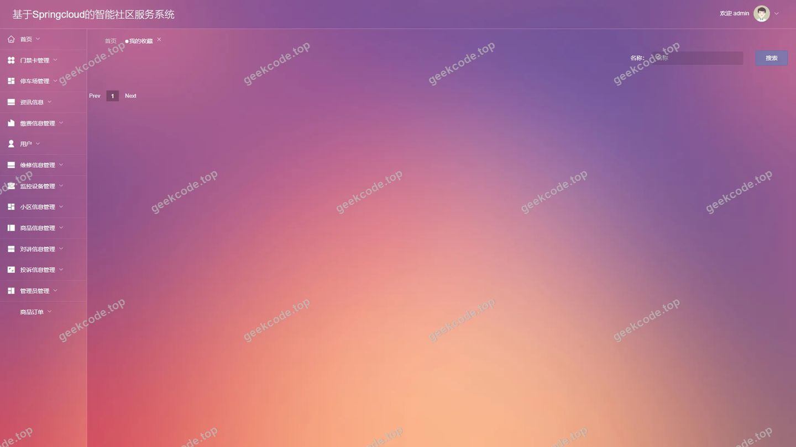
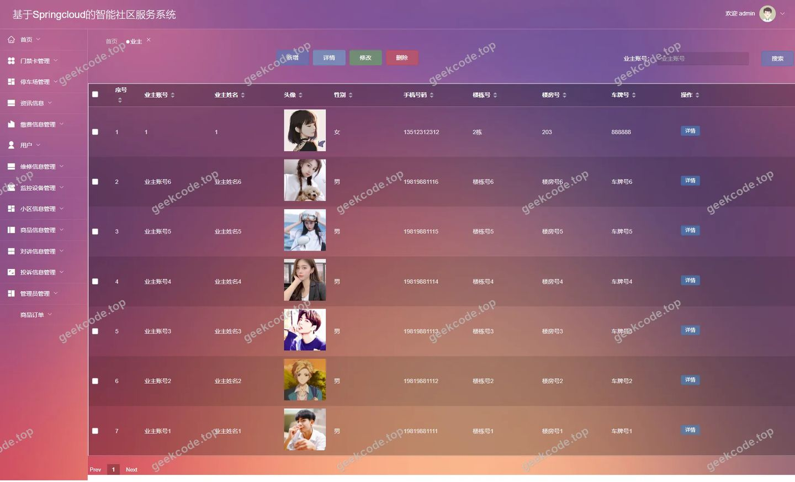
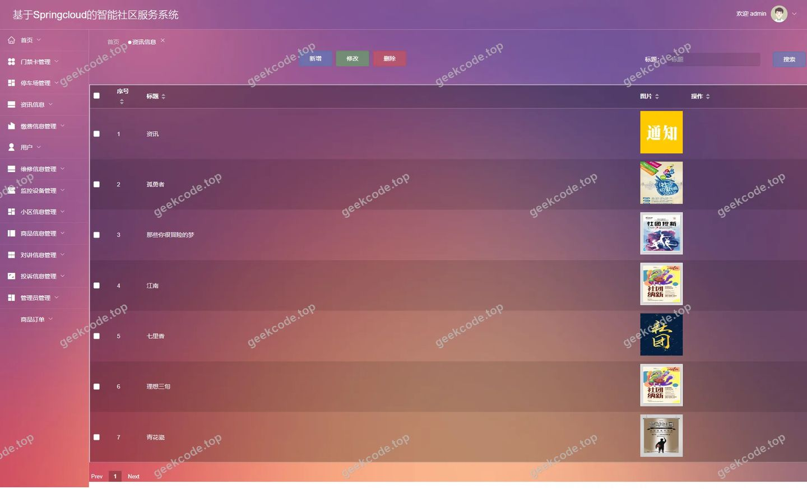

# 基于Springcloud的智能社区服务系统

> 🎓 **计算机毕业设计 · 基于Springcloud的智能社区服务系统**
>
> 本仓库只放**项目介绍 + 运行截图**（截图是站点带水印的原图，存在仓库 `images/` 里）。
>
> 👉 **完整可运行源码 / 数据库脚本 / 部署文档：[点我获取](https://geekcode.top/archives/%E5%9F%BA%E4%BA%8ESpringcloud%E7%9A%84%E6%99%BA%E8%83%BD%E7%A4%BE%E5%8C%BA%E6%9C%8D%E5%8A%A1%E7%B3%BB%E7%BB%9F?utm_source=github)**
>
> 💬 咨询微信：**ir9372**　|　🌐 更多项目：[极客代码 geekcode.top](https://geekcode.top/?utm_source=github)
>
> 📌 项目详情页：<https://geekcode.top/archives/%E5%9F%BA%E4%BA%8ESpringcloud%E7%9A%84%E6%99%BA%E8%83%BD%E7%A4%BE%E5%8C%BA%E6%9C%8D%E5%8A%A1%E7%B3%BB%E7%BB%9F?utm_source=github>

<table><td width="230" align="center"> <b>扫码加微信 ir9372</b></td><td valign="middle">📦 源码 = 项目介绍 + 全部运行截图 + 数据库 + 部署文档 👉 点上方任意截图，直接跳到 <b>极客代码 geekcode.top</b> 详情页</td></table>

---

<h1>基于Springcloud的智能社区服务系统</h1>
<h2>项目概述</h2>

本项目为“基于Springcloud的智能社区服务系统”，旨在构建一个集物业管理、商业服务、居民互动于一体的综合性社区服务平台。系统采用前后端分离架构，后端基于 Spring Boot 框架构建微服务生态，前端使用 Vue 技术栈实现交互界面。核心功能涵盖业主管理、商家入驻、商品交易、物业维修申请、停车管理及缴费信息等模块。适用人群包括社区居民（业主）、物业公司管理人员及社区周边商户。通过数字化手段优化社区资源配置，提升物业服务效率与居民生活便利性，解决传统社区管理中信息不对称、流程繁琐等痛点。

<h2>技术架构</h2>
<h3>1. 总体架构</h3>

系统采用 B/S 架构，遵循 MVC 设计模式，分为表现层、业务逻辑层和数据持久层。

<ul>
<li><strong>前端</strong>：基于 Vue.js 框架开发，利用 Element UI 或类似组件库构建用户界面，通过 Axios 发起 HTTP 请求与后端进行数据交互。支持响应式布局，适配不同终端设备。</li>
<li><strong>后端</strong>：基于 Spring Boot 框架，整合 MyBatis 或 JPA 作为 ORM 映射工具，处理业务逻辑、权限验证及数据接口提供。虽然项目名称提及 Spring Cloud，但根据提供的代码上下文和技术依赖仅明确列出 Spring Boot，故主要描述单体应用或模块化服务的标准 Spring Boot 架构特征。</li>
<li><strong>数据库</strong>：使用 MySQL 关系型数据库存储结构化数据，包括用户信息、订单记录、维修工单、商品详情等。</li>
</ul>
<h3>2. 核心技术选型理由</h3>
<ul>
<li><strong>Spring Boot</strong>：简化配置，快速搭建企业级应用，内置 Tomcat 容器，便于部署和维护。</li>
<li><strong>Vue.js</strong>：轻量级、双向数据绑定机制使得前端状态管理清晰，组件化开发提高代码复用率。</li>
<li><strong>MySQL</strong>：成熟稳定的开源关系型数据库，支持事务处理，适合存储社区业务中复杂的关联数据。</li>
</ul>
<h3>3. 数据交互流程</h3>

<h2>功能模块</h2>

根据后台路由 <code>/shangjiaCenter</code>, <code>/wuyerenyuanCenter</code> 以及前台路由 <code>/index/...</code> 和截图功能列表，系统主要划分为以下功能模块：

<h3>1. 前台用户端（面向业主、商家、物业人员）</h3>
<h4>1.1 首页与资讯</h4>
<ul>
<li><strong>首页展示</strong>：展示社区公告、热门商品、最新维修动态等信息入口。</li>
<li><strong>新闻资讯</strong>：查看社区新闻、政策通知等内容（对应路由 <code>/news</code>, <code>/index/newsList</code>）。</li>
</ul>
<h4>1.2 业主中心</h4>
<ul>
<li><strong>个人信息管理</strong>：注册、登录、修改个人资料（对应路由 <code>/index/yezhuAdd</code>, <code>/index/yezhuDetail</code>）。</li>
<li><strong>我的地址</strong>：管理收货地址或家庭住址（对应路由 <code>/address</code>, <code>/index/addressList</code>）。</li>
<li><strong>我的收藏</strong>：查看收藏的商品或服务（对应路由 <code>/storeup</code>, <code>/index/storeupList</code>）。</li>
<li><strong>购物车</strong>：选购商品并结算（对应路由 <code>/index/cartList</code>）。</li>
</ul>
<h4>1.3 商品与服务</h4>
<ul>
<li><strong>商品浏览</strong>：按分类查看商品信息，搜索特定商品（对应路由 <code>/shangpinxinxi</code>, <code>/index/shangpinxinxiList</code>）。</li>
<li><strong>商品分类</strong>：查看不同类别的商品列表（对应路由 <code>/shangpinfenlei</code>, <code>/index/shangpinfenleiList</code>）。</li>
<li><strong>维修服务</strong>：提交维修申请，查看维修进度（对应路由 <code>/weixiushenqing</code>, <code>/index/weixiushenqingAdd</code>）。</li>
</ul>
<h4>1.4 物业管理相关</h4>
<ul>
<li><strong>小区信息</strong>：查看小区基本概况（对应路由 <code>/xiaoquxinxi</code>, <code>/index/xiaoquxinxiList</code>）。</li>
<li><strong>房屋信息</strong>：查询名下房产或租赁房屋详情（对应路由 <code>/fangwuxinxi</code>, <code>/index/fangwuxinxiList</code>）。</li>
<li><strong>停车管理</strong>：车辆入场、出场记录查询（对应路由 <code>/cheliangruchang</code>, <code>/cheliangchuchang</code>）。</li>
<li><strong>缴费管理</strong>：查看各类费用账单及缴纳记录（对应路由 <code>/jiaofeixinxi</code>, <code>/jiaofeileixing</code>）。</li>
</ul>
<h3>2. 后台管理端（面向超级管理员、物业管理员、商家管理员）</h3>
<h4>2.1 系统基础管理</h4>
<ul>
<li><strong>用户管理</strong>：<ul>
<li><strong>业主管理</strong>：增删改查业主账号信息（对应路由 <code>/yezhu</code>）。</li>
<li><strong>商家管理</strong>：审核商家入驻，管理商家账号（对应路由 <code>/shangjia</code>, <code>/shangjiaRegister</code>）。</li>
<li><strong>物业人员管理</strong>：维护物业员工档案（对应路由 <code>/wuyerenyuan</code>, <code>/wuyerenyuanRegister</code>）。</li>
</ul>
</li>
<li><strong>系统配置</strong>：全局参数设置（对应路由 <code>/config</code>）。</li>
</ul>
<h4>2.2 业务数据管理</h4>
<ul>
<li><strong>商品管理</strong>：<ul>
<li><strong>商品信息</strong>：上架、下架、编辑商品详情（对应路由 <code>/shangpinxinxi</code>）。</li>
<li><strong>商品分类</strong>：维护商品类目结构（对应路由 <code>/shangpinfenlei</code>）。</li>
</ul>
</li>
<li><strong>服务管理</strong>：<ul>
<li><strong>维修信息</strong>：处理业主提交的维修工单，指派人员，反馈结果（对应路由 <code>/weixiuxinxi</code>）。</li>
<li><strong>投诉信息</strong>：接收并处理业主的投诉建议（对应路由 <code>/tousuxinxi</code>）。</li>
</ul>
</li>
<li><strong>财务与资产</strong>：<ul>
<li><strong>缴费信息</strong>：生成和管理各类物业费用账单（对应路由 <code>/jiaofeixinxi</code>）。</li>
<li><strong>停车场管理</strong>：维护车位信息及车辆进出记录（对应路由 <code>/tingchechang</code>, <code>/cheliangruchang</code>, <code>/cheliangchuchang</code>）。</li>
<li><strong>监控设备</strong>：管理社区监控硬件资源（对应路由 <code>/jiankongshebei</code>）。</li>
<li><strong>一卡通管理</strong>：处理门禁卡或消费卡相关业务（对应路由 <code>/yikatong</code>）。</li>
</ul>
</li>
<li><strong>内容管理</strong>：<ul>
<li><strong>资讯管理</strong>：发布和管理社区新闻公告（对应路由 <code>/news</code>）。</li>
<li><strong>对奖信息</strong>：管理社区抽奖或积分兑换活动（对应路由 <code>/duijiangxinxi</code>）。</li>
</ul>
</li>
</ul>
<h4>2.3 订单与售后</h4>
<ul>
<li><strong>订单管理</strong>：查看所有商品交易订单状态（对应路由 <code>/orders</code>）。</li>
<li><strong>评论管理</strong>：审核用户对商品或服务的评论（对应路由 <code>/discussshangpinxinxi</code>）。</li>
</ul>
<h2>用户角色与权限</h2>

系统涉及三种主要角色：普通业主、商家、物业工作人员（含管理员）。

<h3>1. 普通业主 (Yezhu)</h3>
<ul>
<li><strong>权限范围</strong>：仅限个人数据操作及公共服务查询。</li>
<li><strong>可访问模块</strong>：<ul>
<li>个人中心：修改密码、完善资料、管理地址。</li>
<li>购物模块：浏览商品、加入购物车、下单购买、查看订单、收藏商品。</li>
<li>物业模块：提交维修申请、查看维修进度、查看缴费账单、查询车辆进出记录、提交投诉。</li>
<li>资讯模块：阅读新闻公告。</li>
</ul>
</li>
</ul>
<h3>2. 商家 (Shangjia)</h3>
<ul>
<li><strong>权限范围</strong>：管理自身店铺商品及订单。</li>
<li><strong>可访问模块</strong>：<ul>
<li>店铺中心：完善店铺信息（<code>/shangjiaCenter</code>）。</li>
<li>商品管理：添加、编辑、删除自家商品（<code>/shangpinxinxi</code>），管理商品分类（若开放）。</li>
<li>订单管理：查看和处理属于本店铺的订单（<code>/orders</code>）。</li>
<li>评价管理：查看顾客对本店商品的评论（<code>/discussshangpinxinxi</code>）。</li>
</ul>
</li>
</ul>
<h3>3. 物业工作人员/管理员 (Wuyerenyuan / Admin)</h3>
<ul>
<li><strong>权限范围</strong>：拥有最高或较高权限，负责整个社区系统的运营与维护。</li>
<li><strong>可访问模块</strong>：<ul>
<li>综合管理：业主信息管理、商家审核、内部员工管理（<code>/yezhu</code>, <code>/shangjia</code>, <code>/wuyerenyuan</code>）。</li>
<li>物业服务：处理所有维修工单（<code>/weixiuxinxi</code>）、回复投诉（<code>/tousuxinxi</code>）、发布社区资讯（<code>/news</code>）。</li>
<li>资产管理：维护房屋信息（<code>/fangwuxinxi</code>）、小区基本信息（<code>/xiaoquxinxi</code>）、监控设备（<code>/jiankongshebei</code>）、停车场及车辆记录（<code>/tingchechang</code>, <code>/cheliangruchang</code>）。</li>
<li>财务管理：制定缴费类型、生成缴费通知、核对一卡通数据（<code>/jiaofeileixing</code>, <code>/jiaofeixinxi</code>, <code>/yikatong</code>）。</li>
<li>系统设置：配置系统参数、管理对奖活动（<code>/config</code>, <code>/duijiangxinxi</code>）。</li>
</ul>
</li>
</ul>
<h2>项目特色与创新点</h2>
<ol>
<li><strong>全场景覆盖</strong>：系统不仅包含传统的电商购物功能，还深度集成了物业特有的维修、停车、缴费、投诉等业务，实现了“生活+服务”的一站式闭环。</li>
<li><strong>多角色协同机制</strong>：设计了业主、商家、物业三方独立且互联的中心（如 <code>/shangjiaCenter</code>, <code>/wuyerenyuanCenter</code>），明确了各方在系统中的职责边界，提升了协作效率。</li>
<li><strong>精细化资产管理</strong>：引入了“监控设备”、“一卡通”、“房屋信息”等具体实体管理模块，体现了智能社区对物理资产的数字化映射能力。</li>
<li><strong>动态服务流程</strong>：通过“维修申请”到“维修信息”处理的流程设计，实现了服务请求的可追溯性和透明化管理。</li>
</ol>
<h2>部署环境</h2>

为确保系统正常运行，需准备以下软件环境：

<ol>
<li><strong>操作系统</strong>：Windows 10/11, Linux (CentOS 7+, Ubuntu 20.04+) 或 macOS。</li>
<li><strong>Java 运行环境</strong>：JDK 1.8 或 JDK 11（推荐 JDK 1.8，兼容性好）。</li>
<li><strong>数据库</strong>：MySQL 5.7 或 MySQL 8.0。需创建对应的数据库实例并导入初始化 SQL 脚本。</li>
<li><strong>构建工具</strong>：Maven 3.6+（用于后端依赖管理和打包）。</li>
<li><strong>前端环境</strong>：Node.js 14.x 或更高版本，npm 或 yarn（用于安装前端依赖及编译 Vue 项目）。</li>
<li><strong>Web 服务器</strong>：Nginx（可选，用于反向代理前端静态资源和后端接口）或直接使用 Spring Boot 内置 Tomcat。</li>
<li><strong>其他</strong>：Git（版本控制），IDE（IntelliJ IDEA 用于后端，VS Code 用于前端）。</li>
</ol>
<h2>五、技术特性</h2>
<ul>
<li>前后端集成部署，前端资源打包至后端 static 目录</li>
</ul>
<h2>六、功能模块截图</h2>
<h3>前台用户端</h3>
<h4>前台-首页</h4>

<h4>前台-登录</h4>

<h4>前台-yezhu注册</h4>

<h3>后台管理端</h3>
<h4>后台-地址</h4>

<h4>后台-登录页</h4>

<h4>后台-商品信息</h4>

<h4>后台首页</h4>

<h4>后台-维修信息</h4>

<h4>后台-我的收藏</h4>

<h4>后台-业主</h4>

<h4>后台-资讯信息</h4>

---

## 获取完整源码

| 项目 | 说明 |
| --- | --- |
| 项目名 | 基于Springcloud的智能社区服务系统 |
| 运行截图 | 本文 12 张（站点带水印原图，仓库 `images/` 目录） |
| 完整源码 | [https://geekcode.top/archives/%E5%9F%BA%E4%BA%8ESpringcloud%E7%9A%84%E6%99%BA%E8%83%BD%E7%A4%BE%E5%8C%BA%E6%9C%8D%E5%8A%A1%E7%B3%BB%E7%BB%9F?utm_source=github](https://geekcode.top/archives/%E5%9F%BA%E4%BA%8ESpringcloud%E7%9A%84%E6%99%BA%E8%83%BD%E7%A4%BE%E5%8C%BA%E6%9C%8D%E5%8A%A1%E7%B3%BB%E7%BB%9F?utm_source=github) |
| 咨询微信 | **ir9372**（备注：jingpin-yuanma） |
| 更多项目 | [极客代码 geekcode.top](https://geekcode.top/?utm_source=github) |

> 需要源码、部署、改配置、跑不起来等问题，加微信 ir9372 沟通，说明项目名即可。
